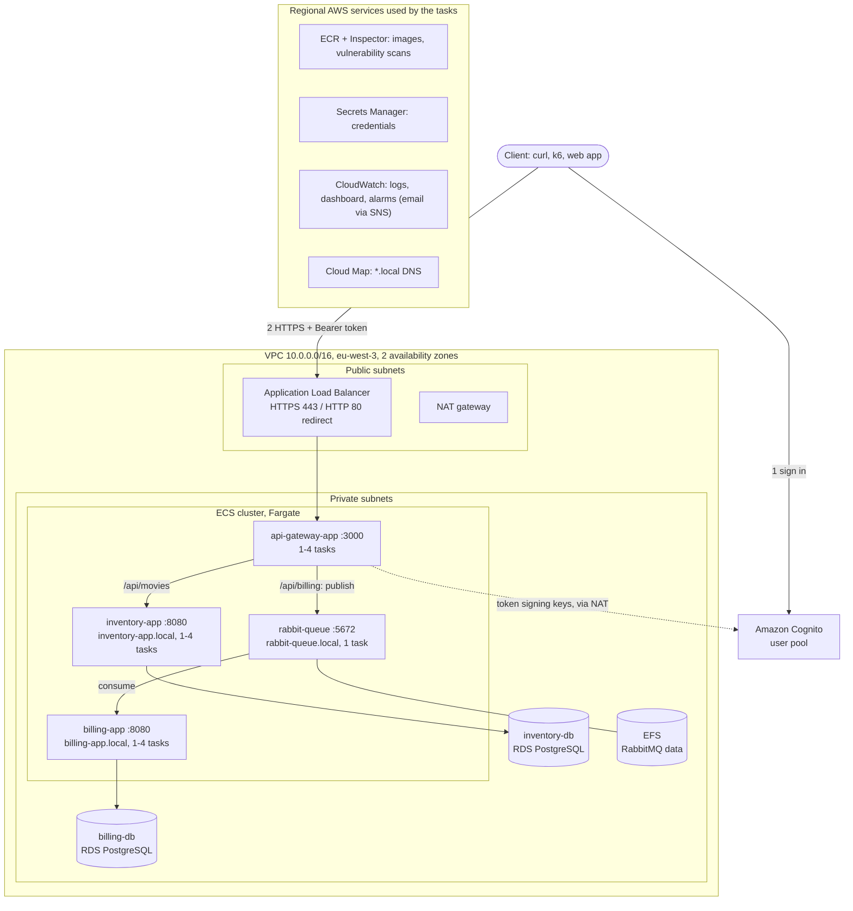
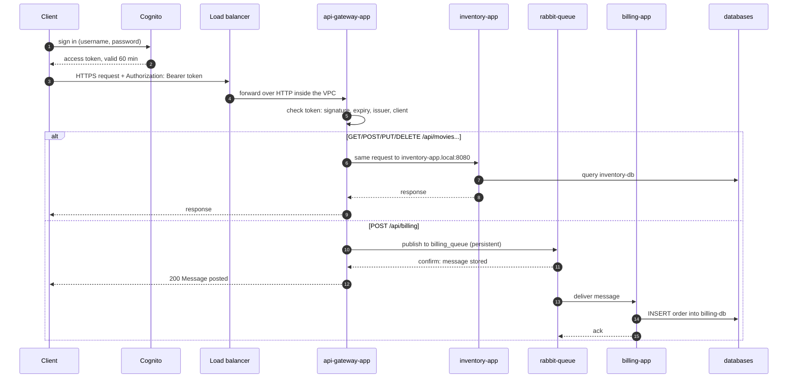

# Cloud-Design

A microservices application (movie inventory + order billing) deployed on
AWS with Terraform, Docker and Amazon ECS on Fargate. This document
describes the architecture and the reasons behind it, then how to deploy,
verify, use and tear down the solution. The task split between the two team
members is in [Tasks.md](Tasks.md).

- [Architecture](#architecture)
- [Design decisions](#design-decisions)
- [Repository layout](#repository-layout)
- [Prerequisites](#prerequisites)
- [Configuration](#configuration)
- [Deploying](#deploying)
- [Verifying the deployment](#verifying-the-deployment)
- [Using the API](#using-the-api)
- [Billing queue resilience](#billing-queue-resilience)
- [Monitoring and logging](#monitoring-and-logging)
- [Load testing and auto-scaling](#load-testing-and-auto-scaling)
- [Vulnerability scanning](#vulnerability-scanning)
- [Cost management and tearing down](#cost-management-and-tearing-down)

## Architecture

### Overview



### Components

**Application containers** (all on ECS Fargate, in the private subnets):

- **api-gateway-app** (port 3000): the only service reachable from outside,
  through the load balancer. It checks the caller's Cognito token, forwards
  `/api/movies` requests to inventory-app, and publishes `/api/billing`
  orders to RabbitMQ. Runs 1 to 4 tasks.
- **inventory-app** (port 8080): REST API to create, list, update and
  delete movies, stored in inventory-db. Only the gateway can reach it, at
  `inventory-app.local`. Runs 1 to 4 tasks.
- **billing-app** (port 8080, health endpoint): takes orders from
  `billing_queue` and writes them to billing-db. It acknowledges a message
  only after the insert succeeds, so an order is not lost if it crashes.
  Runs 1 to 4 tasks, which share the queue.
- **rabbit-queue** (port 5672): RabbitMQ broker holding the durable
  `billing_queue`. One task, with its data directory on EFS so queued
  messages survive the task being replaced.

**Databases:**

- **inventory-db** and **billing-db** (port 5432): PostgreSQL on Amazon RDS,
  in the private subnets, encrypted at rest, with 7 days of automated
  backups. RDS handles patching and backups that a database container
  would need by hand.

**AWS services around them:**

- **VPC**: 2 public and 2 private subnets across 2 availability zones. Only
  the load balancer and the NAT gateway are in the public subnets; the NAT
  gateway gives the private subnets outbound-only internet access.
- **Application Load Balancer**: public entry point. It terminates HTTPS
  with an ACM certificate and forwards requests to healthy gateway tasks.
- **Amazon Cognito**: user pool that signs users in and issues the access
  tokens the gateway checks.
- **Amazon ECS on Fargate**: runs the containers without servers to manage,
  and replaces tasks that crash or fail their health check. Application
  Auto Scaling changes the number of tasks with the load.
- **AWS Cloud Map**: private DNS names (`*.local`) that always point to the
  healthy tasks of each service.
- **Amazon ECR and Amazon Inspector**: private image registry. Inspector
  scans every image for known vulnerabilities, and keeps re-checking them.
- **AWS Secrets Manager**: database, RabbitMQ and test-user credentials,
  given to the containers when they start.
- **Amazon CloudWatch**: container logs, the metrics and alarms that drive
  auto-scaling, and a dashboard with alarms that email the team (through
  Amazon SNS) when a database or RabbitMQ has a problem.

| Component | Terraform module (task) |
|-----------|-------------------------|
| VPC, subnets, NAT, security groups | `terraform/aymen/01-networking` (1) |
| inventory-db, billing-db | `terraform/aymen/02-databases` (2) |
| rabbit-queue task definition, EFS, queue secret | `terraform/aymen/04-messaging` (4) |
| ECR repositories, Inspector scanning | `terraform/houda/ecr` (6, 8) |
| ECS cluster and services, load balancer, Cloud Map | `terraform/houda/platform` (6, 7) |
| HTTPS certificate, Cognito, IAM roles | `terraform/houda/platform` (8) |
| Auto-scaling policies | `terraform/houda/platform` (9) |
| Dashboard, alarms, alert emails | `terraform/aymen/05-monitoring` (5) |

### Request flow



Billing is asynchronous: the client gets its answer as soon as RabbitMQ
confirms that it has stored the order in the queue (publisher confirms). If
billing-app is down, orders wait in the queue instead of failing (see
[Billing queue resilience](#billing-queue-resilience)). If billing-db is
down, billing-app puts the order back in the queue and tries again every 5
seconds until the database is back. An order that can't be read (missing
fields) is logged and dropped, so it doesn't block the queue.

Routing done by the gateway:

| Path | Methods | Goes to | Needs a token |
|------|---------|---------|---------------|
| `/health` | GET | answered by the gateway (also the load balancer health check) | no |
| `/api/movies` | GET, POST, DELETE | `http://inventory-app.local:8080/api/movies` | yes |
| `/api/movies/{id}` | GET, PUT, DELETE | `http://inventory-app.local:8080/api/movies/{id}` | yes |
| `/api/billing` | POST | message on `billing_queue` | yes |

The full API is described in [openapi.yaml](openapi.yaml).

### Network and security groups


Only the load balancer has a public address. Everything else is in private
subnets, and each security group accepts traffic only from the tier in
front of it. Outbound traffic from the private subnets (image pulls,
Secrets Manager, Cognito keys, logs) goes through the NAT gateway.

## Design decisions

### Scalability

- The three app services scale independently between 1 and 4 tasks, with
  target-tracking policies: 60 % CPU for all three, plus 600 requests per
  minute per task for the gateway, whose work is mostly waiting on other
  services.
- The apps keep no state in the container: data is in RDS and orders are in
  the queue. Any task can serve any request, so adding tasks is enough.
- The queue absorbs traffic spikes on billing: the gateway accepts orders at
  its own pace, and billing tasks share the queue (RabbitMQ gives each
  message to one consumer), so more billing tasks means faster processing.
- Limits: the single RabbitMQ broker and the single-instance databases don't
  scale out. They are far from being the bottleneck at this project's load;
  the next steps would be Amazon MQ and RDS read replicas.

### Availability

- The load balancer spans two availability zones, and when a service runs
  more than one task, ECS spreads them across both. The load balancer only
  sends traffic to tasks that pass `/health`.
- Every service has a container health check (`/health` for the apps, the
  AMQP port for RabbitMQ). ECS replaces any task that crashes or fails it,
  and removes it from Cloud Map DNS in the meantime.
- Deployments have a circuit breaker: if the new version keeps failing, ECS
  rolls back to the previous one.
- RabbitMQ data is on EFS (stored across several zones), so queued messages
  survive the broker task being replaced. Messages are persistent and
  acknowledged only after the database insert.
- Trade-offs accepted for cost: a single NAT gateway, single-AZ databases
  (`multi_az = false`) and one broker. Each is one setting or resource away
  from being redundant.

### Security

- **Encryption in transit:** the internet only reaches the load balancer,
  over HTTPS (HTTP redirects to it) with a TLS 1.2+ policy. Inside the VPC,
  database connections are encrypted (RDS for PostgreSQL 16 requires SSL by
  default) and so is EFS traffic. The HTTP calls from the gateway to
  inventory-app and the AMQP connections to RabbitMQ are not encrypted: they
  never leave the private subnets, only the listed security groups can open
  them, and RabbitMQ requires a username and password. Encrypting those too
  (ECS Service Connect TLS) needs AWS Private CA, which would cost more per
  month than the rest of the project.
- **Encryption at rest:** RDS, EFS, ECR, Secrets Manager and CloudWatch
  Logs all store data encrypted.
- **Managed authentication:** every `/api/*` endpoint requires a Cognito
  access token. The gateway checks its signature against the user pool's
  published keys, its expiry and issuer, and that it was issued to this
  app's client (`srcs/api-gateway-app/app/auth.py`). Requests without a
  valid token get `401`. The gateway refuses to start without the user
  pool settings, so it can never run with authentication turned off.
- **Private resources:** databases, RabbitMQ and all tasks are in private
  subnets without public IPs; the databases accept connections only from
  the app tasks.
- **No credentials in the repository:** database, RabbitMQ and test-user
  passwords are generated by Terraform, stored in Secrets Manager and
  injected by ECS when a container starts. `terraform.tfvars` and the state
  files are git-ignored.
- **Least-privilege IAM:** each app service has its own execution role that
  can read only its own secrets, and a task role that allows only ECS Exec
  (the apps call no AWS APIs).
- **Vulnerability scanning:** Amazon Inspector scans every image pushed to
  ECR and re-checks it continuously as new vulnerabilities are published.
- **Why not Amazon API Gateway:** the ALB with Cognito tokens checked by the
  gateway container gives the same protection without a second, paid
  gateway in front of the one the application already has.

### Cost

- Fargate tasks are small (0.25 vCPU, 512 MB) and run at 1 per service when
  idle; auto-scaling adds capacity only under load.
- Service discovery uses Cloud Map DNS instead of an internal load
  balancer, and the databases use the smallest RDS class (`db.t4g.micro`).
- ECR keeps only the last 5 images per repository; logs expire after 7-14
  days.
- The biggest fixed costs are the NAT gateway, the load balancer and the two
  RDS instances, all billed per hour, so everything is destroyed with
  `terraform destroy` after testing.

### Simplicity

- Fargate instead of EC2 or EKS: no servers or Kubernetes control plane to
  run for four services.
- A single public entry point: the load balancer forwards everything to the
  gateway, which does the routing already defined by the application.
- Each task owner's Terraform is a separate module that can be applied on
  its own. The modules read each other's outputs from state, so no IDs are
  copied by hand.
- The Python app images are multi-stage builds on
  `python:3.12-slim-trixie`: build tools and pip caches stay in the build
  stage, which keeps images small.

## Repository layout

| Path | Contents |
|------|----------|
| `srcs/` | Application source code |
| `Dockerfiles/` | One Dockerfile per image |
| `terraform/aymen/` | Networking, databases, messaging, monitoring (tasks 1, 2, 4, 5) |
| `terraform/houda/ecr` | Image repositories and vulnerability scanning (tasks 6, 8) |
| `terraform/houda/platform` | ECS cluster and services, load balancer, HTTPS, Cognito, IAM, auto-scaling (tasks 6-9) |
| `scripts/` | Push images to ECR (`push-images.sh`), get an API token (`get-token.sh`), check the local Docker Compose stack (`smoke-test.sh`, `test-billing-consumer.sh`) |
| `load-test/` | k6 load test and scaling monitor (task 9) |
| `docker-compose.yml`, `LOCAL_TESTING.md` | Run the backend services (all but the gateway, which needs Cognito) locally with Docker Compose and check them with `docker ps` (task 3) |

Each Terraform module has its own README with more detail.

## Prerequisites

- An AWS account and an IAM user allowed to create the resources above
  (the project used `AdministratorAccess`), with an access key set up with
  `aws configure` and region `eu-west-3`
- AWS CLI v2, Terraform 1.5 or newer, Docker or Podman, Python 3, curl
- One checkout containing both `terraform/aymen/` and `terraform/houda/`:
  the modules read each other's state files through relative paths

None of the tools need root. For example, the AWS CLI installs into your home
directory:

```bash
curl https://awscli.amazonaws.com/awscli-exe-linux-x86_64.zip -o awscliv2.zip
unzip -q awscliv2.zip
./aws/install --install-dir ~/.local/aws-cli --bin-dir ~/.local/bin
```

## Configuration

Each module has a `terraform.tfvars.example`. Copy it to `terraform.tfvars`
(git-ignored) and change values there. The defaults deploy the whole
project in `eu-west-3` with the name prefix `cloud-design`.

Main settings of `terraform/houda/platform`:

| Variable | Default | Meaning |
|----------|---------|---------|
| `image_tag` | `latest` | Image tag deployed from ECR |
| `task_cpu`, `task_memory` | `256`, `512` | Size of each app task |
| `autoscaling_min_capacity`, `autoscaling_max_capacity` | `1`, `4` | Task count range per app service |
| `cpu_target_percent` | `60` | CPU the scaling policies aim for |
| `gateway_requests_per_target` | `600` | Requests per minute per gateway task before scaling out |
| `domain_name`, `route53_zone_id` | not set | Your own domain: ACM issues and validates a public certificate. Not set: a self-signed certificate is imported into ACM |
| `test_user_email` | `loadtest@example.com` | Cognito user created for tests |

The network (CIDRs, zones), database (instance class, Multi-AZ, backup
retention) and RabbitMQ settings are described in the READMEs of the
`terraform/aymen/` modules.

## Deploying

Each module is applied from its own directory, in this order. Each one
first needs `cp terraform.tfvars.example terraform.tfvars`.

```bash
# 1. Network (VPC, subnets, NAT, security groups)
cd terraform/aymen/01-networking
terraform init && terraform plan -var-file=terraform.tfvars && terraform apply -var-file=terraform.tfvars

# 2. Databases (RDS + their secrets)
cd ../02-databases
terraform init && terraform apply -var-file=terraform.tfvars

# 3. Image repositories and scanning, then build and push the images
cd ../../houda/ecr
terraform init && terraform apply -var-file=terraform.tfvars
cd ../../.. && scripts/push-images.sh

# 4. RabbitMQ task definition, EFS and secret, using the pushed image
cd terraform/aymen/04-messaging
terraform init && terraform apply -var-file=terraform.tfvars \
  -var "container_image=$(terraform -chdir=../../houda/ecr output -raw rabbit_queue_image)"

# 5. Cluster, services, load balancer, security, auto-scaling
cd ../../houda/platform
terraform init && terraform apply -var-file=terraform.tfvars
terraform output app_url

# 6. Dashboard and alarms (set alert_email in terraform.tfvars first)
cd ../../aymen/05-monitoring
terraform init && terraform apply -var-file=terraform.tfvars
```

After step 6, AWS emails `alert_email` a confirmation link: alarm emails
are only sent once it's clicked.

The services take 2-3 minutes after step 5 to start and pass their health
checks.

## Verifying the deployment

```bash
CLUSTER=cloud-design-cluster

# Every service: desired vs running tasks and the latest event
aws ecs describe-services --cluster $CLUSTER \
  --services api-gateway-service inventory-service billing-service rabbit-queue-service \
  --query 'services[].{name:serviceName,desired:desiredCount,running:runningCount,event:events[0].message}' \
  --output table

# Running tasks with their status and health
aws ecs describe-tasks --cluster $CLUSTER \
  --tasks $(aws ecs list-tasks --cluster $CLUSTER --query 'taskArns[]' --output text) \
  --query 'tasks[].{task:group,status:lastStatus,health:healthStatus,zone:availabilityZone}' --output table

# Load balancer targets: every gateway task should be "healthy"
TG=$(aws elbv2 describe-target-groups --names cloud-design-api-gateway-tg \
  --query 'TargetGroups[0].TargetGroupArn' --output text)
aws elbv2 describe-target-health --target-group-arn $TG \
  --query 'TargetHealthDescriptions[].[Target.Id,TargetHealth.State]' --output table

# Service discovery: the private IPs behind each internal name
aws servicediscovery discover-instances --namespace-name local --service-name inventory-app \
  --query 'Instances[].Attributes.AWS_INSTANCE_IPV4'

# Logs of a service (stream prefixes: api-gateway, inventory, billing)
aws logs tail /ecs/cloud-design --follow --log-stream-name-prefix inventory
aws logs tail /ecs/cloud-design-rabbit-queue --follow
```

More commands (stopped tasks, forcing a redeploy, a shell inside a
container with ECS Exec) are in
[terraform/houda/platform/README.md](terraform/houda/platform/README.md#cluster-access-task-6).

## Using the API

```bash
cd terraform/houda/platform
APP_URL=$(terraform output -raw app_url)

# Plain HTTP is redirected to HTTPS
curl -sI "${APP_URL/https:/http:}/health" | head -1   # HTTP/1.1 301 Moved Permanently

# No token: rejected
curl -k -i "$APP_URL/api/movies"                  # 401 Missing bearer token

# Get a Cognito access token for the test user (valid 60 minutes)
TOKEN=$(../../../scripts/get-token.sh)
AUTH="Authorization: Bearer $TOKEN"

curl -k "$APP_URL/health"
curl -k -H "$AUTH" -H "Content-Type: application/json" \
  -d '{"title": "Inception", "description": "Dreams within dreams"}' "$APP_URL/api/movies"
curl -k -H "$AUTH" "$APP_URL/api/movies"
curl -k -H "$AUTH" "$APP_URL/api/movies/1"
curl -k -H "$AUTH" -H "Content-Type: application/json" \
  -d '{"user_id": "3", "number_of_items": 5, "total_amount": 180}' "$APP_URL/api/billing"
```

`-k` accepts the self-signed certificate that the load balancer uses when
no domain is configured. `scripts/get-token.sh` reads the test user's
password from Secrets Manager and signs in with Cognito.

The Cognito setup can be shown with:

```bash
POOL=$(terraform output -raw cognito_user_pool_id)
aws cognito-idp describe-user-pool --user-pool-id $POOL \
  --query 'UserPool.{name:Name,passwordPolicy:Policies.PasswordPolicy}'
aws cognito-idp describe-user-pool-client --user-pool-id $POOL \
  --client-id $(terraform output -raw cognito_client_id) \
  --query 'UserPoolClient.{name:ClientName,authFlows:ExplicitAuthFlows,accessTokenMinutes:AccessTokenValidity}'
aws cognito-idp list-users --user-pool-id $POOL --query 'Users[].[Username,UserStatus]'
```

To create more users:

```bash
aws cognito-idp admin-create-user --user-pool-id $POOL --username someone@example.com \
  --user-attributes Name=email,Value=someone@example.com Name=email_verified,Value=true \
  --message-action SUPPRESS
aws cognito-idp admin-set-user-password --user-pool-id $POOL --username someone@example.com \
  --password '<a strong password>' --permanent
```

## Billing queue resilience

Orders sent while billing-app is stopped wait in RabbitMQ and are processed
when it comes back. To show it (continuing from the previous section):

```bash
CLUSTER=cloud-design-cluster
TARGET=service/$CLUSTER/billing-service

# 1. Stop billing-app. Auto-scaling is paused first so it doesn't start a task again.
aws application-autoscaling register-scalable-target --service-namespace ecs \
  --scalable-dimension ecs:service:DesiredCount --resource-id $TARGET \
  --suspended-state DynamicScalingInSuspended=true,DynamicScalingOutSuspended=true,ScheduledScalingSuspended=true
aws ecs update-service --cluster $CLUSTER --service billing-service --desired-count 0 >/dev/null
aws ecs wait services-stable --cluster $CLUSTER --services billing-service
# ...and until its task has really exited (it counts as not running as soon as it starts stopping)
aws ecs wait tasks-stopped --cluster $CLUSTER --tasks $(aws ecs list-tasks --cluster $CLUSTER \
  --service-name billing-service --desired-status STOPPED --query 'taskArns[]' --output text)

# 2. Send an order: still accepted (200 Message posted), it waits in the queue
curl -k -H "$AUTH" -H "Content-Type: application/json" \
  -d '{"user_id": "42", "number_of_items": 1, "total_amount": 9.99}' "$APP_URL/api/billing"

# 3. Start billing-app again and resume auto-scaling
aws ecs update-service --cluster $CLUSTER --service billing-service --desired-count 1 >/dev/null
aws application-autoscaling register-scalable-target --service-namespace ecs \
  --scalable-dimension ecs:service:DesiredCount --resource-id $TARGET \
  --suspended-state DynamicScalingInSuspended=false,DynamicScalingOutSuspended=false,ScheduledScalingSuspended=false

# 4. The queued order is processed as soon as billing-app connects:
#    "Received order message: {'user_id': '42', ...}" then "Order successfully inserted"
aws logs tail /ecs/cloud-design --log-stream-name-prefix billing --since 10m --follow
```

## Monitoring and logging

| What | Where | Shows |
|------|-------|-------|
| Dashboard `cloud-design-overview` | CloudWatch → **Dashboards** | App: requests per minute, response time (p95), 5xx/4xx errors, healthy gateway targets, running tasks per service, CPU and memory per service, billing orders saved per minute, latest app errors. Databases and queue: RDS CPU, storage and connections, RabbitMQ errors and logs |
| Alarms with email alerts | CloudWatch → **Alarms**, `cloud-design-*` | API down (no healthy gateway task), more than 10 server errors in 5 minutes, a service with no running task, database CPU above 80 %, free storage below 2 GB, more than 50 connections, any error in the RabbitMQ logs. An alarm emails `alert_email` through SNS |
| Auto-scaling alarms | CloudWatch → **Alarms**, `TargetTracking-*` | When each app service scales out and in |
| App service metrics | ECS → cluster → service → **Health and metrics** | CPU, memory and task count of each service |
| Load balancer metrics | EC2 → **Load balancers** → `cloud-design-alb` → **Monitoring** | Requests, response time, 4xx/5xx errors, healthy targets |
| Container logs | CloudWatch → **Log groups** | `/ecs/cloud-design` (one stream per task, prefixes `api-gateway`, `inventory`, `billing`, kept 7 days), `/ecs/cloud-design-rabbit-queue` (kept 14 days) |

Graphs of these metrics during the load tests are in
[terraform/aymen/05-monitoring/README.md](terraform/aymen/05-monitoring/README.md#screenshots).

```bash
# Dashboard link
terraform -chdir=terraform/aymen/05-monitoring output -raw dashboard_url

# Alarms and their current state
aws cloudwatch describe-alarms --alarm-name-prefix cloud-design- \
  --query 'MetricAlarms[].[AlarmName,StateValue]' --output table

# Errors logged by the app services in the last hour
aws logs filter-log-events --log-group-name /ecs/cloud-design \
  --start-time $(( ($(date +%s) - 3600) * 1000 )) --filter-pattern '?ERROR ?Error ?error' \
  --query 'events[].[logStreamName,message]' --output text
```

## Load testing and auto-scaling

`load-test/run-load-test.sh` sends a ramping load through the load balancer
with k6 (run in a container), while `load-test/watch-scaling.sh` records the
task count and CPU of each service. The test scenarios, how to run them, and
the measured results (latency, errors, scaling timeline, CPU at each load
level, tuning decisions) are in [load-test/README.md](load-test/README.md).

```bash
aws application-autoscaling describe-scaling-policies --service-namespace ecs \
  --query 'ScalingPolicies[].[PolicyName,TargetTrackingScalingPolicyConfiguration.TargetValue]' \
  --output table
```

## Vulnerability scanning

```bash
# Severity counts for one image
aws ecr describe-image-scan-findings --repository-name cloud-design/api-gateway-app \
  --image-id imageTag=latest --query 'imageScanFindings.findingSeverityCounts'

# Findings of the deployed images (tag latest), most severe first
aws inspector2 list-findings --sort-criteria field=SEVERITY,sortOrder=DESC \
  --filter-criteria '{"ecrImageRepositoryName":[{"comparison":"PREFIX","value":"cloud-design/"}],"ecrImageTags":[{"comparison":"EQUALS","value":"latest"}],"findingStatus":[{"comparison":"EQUALS","value":"ACTIVE"}]}' \
  --query 'findings[].[resources[0].details.awsEcrContainerImage.repositoryName,severity,title]' --output table
```

`scripts/push-images.sh` pushes plain images (not an image index), because
Inspector can only scan those: otherwise the `latest` tag shows no findings.

When a finding has a fixed version, update the package (in the service's
`requirements.txt` or its Dockerfile) and push the image again: Inspector
scans the new image automatically. Findings in Debian base packages that
have no fix yet stay listed until the base image is updated.

The remaining critical finding is in `rabbit-queue`: Debian 12 ships
RabbitMQ 3.10.8 and Debian has no fixed version. Moving to a newer RabbitMQ
means changing major versions, which can't open the queue data already
stored on EFS, so it is planned as a separate migration. Until then the risk
is limited: RabbitMQ is only reachable from the app tasks inside the private
subnets (its security group allows nothing else) and needs a password.

## Cost management and tearing down

The NAT gateway, the load balancer, the RDS instances and the running tasks
are billed per hour. Check the spending in **Billing and Cost Management →
Cost Explorer**, and destroy everything when you are done testing, in
reverse order:

```bash
cd terraform/aymen/05-monitoring  && terraform destroy -var-file=terraform.tfvars
cd ../../houda/platform           && terraform destroy -var-file=terraform.tfvars
cd ../../aymen/04-messaging       && terraform destroy -var-file=terraform.tfvars
cd ../../houda/ecr                && terraform destroy -var-file=terraform.tfvars
cd ../../aymen/02-databases       && terraform destroy -var-file=terraform.tfvars
cd ../01-networking               && terraform destroy -var-file=terraform.tfvars
```
