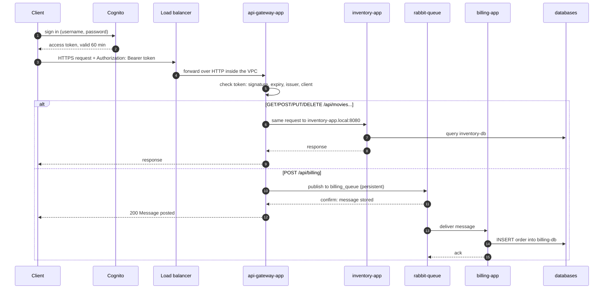
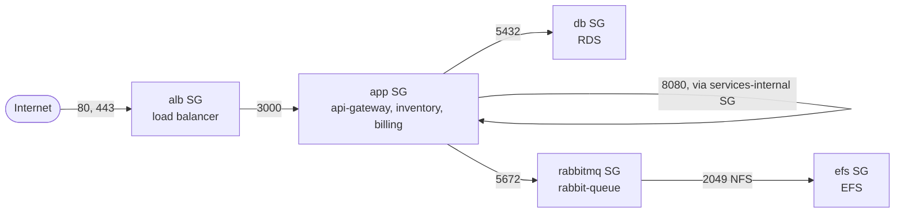

# Cloud-Design

A microservices application (a movie inventory and order billing) deployed on
AWS with Terraform, Docker and Amazon ECS on Fargate. Clients sign in with
Amazon Cognito and call the API over HTTPS through a load balancer. Billing
orders go through a RabbitMQ queue, so none is lost while the billing service
is down.

| Section | What you find there |
|---------|---------------------|
| [1. Architecture](#1-architecture) | What runs where, with diagrams |
| [2. Design decisions](#2-design-decisions) | Why it is built this way, problems we solved, what we would change |
| [3. Project files](#3-project-files) | What every file in the repository does |
| [4. Prerequisites and configuration](#4-prerequisites-and-configuration) | Tools, AWS access, settings |
| [5. Commands](#5-commands) | Deploy, update, load test, debug, tear down |
| [6. Docker images](#6-docker-images) | How the images were optimized, sizes and build times |

Using AWS step by step, the commands for the audit and the Postman
collection are in [COMMANDS.md](COMMANDS.md). The task split between the
two team members is in [Tasks.md](Tasks.md).

## 1. Architecture

### Overview


### Services

| Service | Port | Where it runs | What it does |
|---------|------|---------------|--------------|
| api-gateway-app | 3000 | ECS Fargate, 1-4 tasks, behind the load balancer | The only service reachable from the internet. Checks the caller's Cognito token, forwards `/api/movies` requests to inventory-app and puts `/api/billing` orders on the RabbitMQ queue |
| inventory-app | 8080 | ECS Fargate, 1-4 tasks, `inventory-app.local` | REST API to create, list, search, update and delete movies in inventory-db |
| billing-app | 8080 (health only) | ECS Fargate, 1-4 tasks, `billing-app.local` | Takes orders from `billing_queue` and saves them in billing-db. It confirms (acks) a message only after the insert, so no order is lost if it crashes |
| rabbit-queue | 5672 | ECS Fargate, 1 task, `rabbit-queue.local` | RabbitMQ broker holding the durable `billing_queue`. Its data is on EFS, so queued orders survive the task being replaced |
| inventory-db, billing-db | 5432 | Amazon RDS for PostgreSQL 16 | One database per service: private, encrypted, 7 days of automated backups |

### AWS services

| AWS service | Used for |
|-------------|----------|
| VPC | 2 public and 2 private subnets in 2 availability zones, an internet gateway, 1 NAT gateway |
| Application Load Balancer | Public entry point: HTTPS on 443, HTTP on 80 redirected to HTTPS |
| Certificate Manager (ACM) | The load balancer's HTTPS certificate |
| Cognito | User pool that signs users in and issues the access tokens the gateway checks |
| ECS on Fargate | Runs the 4 containers without servers to manage, replaces failed tasks |
| Cloud Map | Private DNS names (`*.local`) that always point to the healthy tasks of a service |
| ECR + Inspector | Private image registry; Inspector scans every image for known vulnerabilities, continuously |
| RDS | The two PostgreSQL databases |
| EFS | RabbitMQ's data directory |
| Secrets Manager | Database, RabbitMQ and test-user credentials, given to the containers at start |
| IAM | One execution role and one task role per service, each limited to what that service needs |
| Application Auto Scaling | Target-tracking policies that change the number of tasks of the 3 app services |
| CloudWatch + SNS | Container logs, metrics, a dashboard and alarms that send emails |

### Request flow



Billing is asynchronous: the client gets its answer as soon as RabbitMQ
confirms that it has stored the order (publisher confirms). If billing-app
is down, orders wait in the queue. If billing-db is down, billing-app puts
the order back in the queue and tries again every 5 seconds. An order that
can't be read (missing fields) is logged and dropped, so it doesn't block
the queue.

| Path | Methods | Goes to | Token needed |
|------|---------|---------|--------------|
| `/health` | GET | answered by the gateway (also the load balancer's health check) | no |
| `/api/movies` | GET, POST, DELETE | `http://inventory-app.local:8080/api/movies` | yes |
| `/api/movies/{id}` | GET, PUT, DELETE | `http://inventory-app.local:8080/api/movies/{id}` | yes |
| `/api/billing` | POST | a message on `billing_queue` | yes |

The full API (request bodies, responses, errors) is in [openapi.yaml](openapi.yaml).

### Network and security groups



Only the load balancer has a public address. Everything else is in private
subnets, and each security group accepts traffic only from the tier in
front of it. Outbound traffic from the private subnets (image pulls,
Secrets Manager, Cognito keys, logs) goes through the NAT gateway.

## 2. Design decisions

### Scalability

- The three app services scale independently between 1 and 4 tasks, with
  target-tracking policies: 60 % CPU for all three, plus 600 requests per
  minute per task for the gateway, whose work is mostly waiting on other
  services.
- The apps keep no state in the container: data is in RDS and orders are in
  the queue. Any task can serve any request, so adding tasks is enough.
- The queue absorbs traffic spikes on billing, and several billing tasks
  share the queue (RabbitMQ gives each message to one consumer).
- Limits: the single RabbitMQ broker and the single-instance databases don't
  scale out. They are far from being the bottleneck at this project's load;
  the next steps would be Amazon MQ and RDS read replicas.

### Availability

- The load balancer spans two availability zones, and ECS spreads the tasks
  of a service across both. The load balancer only sends traffic to tasks
  that pass `/health`.
- Every service has a container health check (`/health` for the apps, the
  AMQP port for RabbitMQ). ECS replaces any task that crashes or fails it,
  and removes it from Cloud Map DNS in the meantime.
- Deployments have a circuit breaker: if the new version keeps failing, ECS
  rolls back to the previous one.
- RabbitMQ's data is on EFS (stored across several zones), so queued
  messages survive the broker task being replaced. Messages are persistent
  and acknowledged only after the database insert.
- Trade-offs accepted for cost: a single NAT gateway, single-AZ databases
  (`multi_az = false`) and one broker. Each is one setting or resource away
  from being redundant.

### Security

- **Encryption in transit:** the internet only reaches the load balancer,
  over HTTPS (HTTP redirects to it) with a TLS 1.2/1.3 policy. Inside the
  VPC, database connections are encrypted (RDS for PostgreSQL 16 requires
  SSL: `rds.force_ssl = 1`) and so is EFS traffic. The HTTP calls from the
  gateway to inventory-app and the AMQP connections to RabbitMQ are not
  encrypted: they never leave the private subnets, only the listed security
  groups can open them, and RabbitMQ requires a username and password.
  Encrypting those too (ECS Service Connect TLS) needs AWS Private CA, which
  would cost more per month than the rest of the project.
- **Encryption at rest:** RDS, EFS, ECR, Secrets Manager and CloudWatch
  Logs all store data encrypted.
- **Managed authentication:** every `/api/*` endpoint needs a Cognito access
  token. The gateway checks its signature against the user pool's public
  keys, its expiry and issuer, and that it is an access token issued to this
  app's client (`srcs/api-gateway-app/app/auth.py`). Anything else gets
  `401`. The gateway refuses to start without the user pool settings, so it
  can never run with authentication turned off.
- **Private resources:** databases, RabbitMQ and all tasks are in private
  subnets without public IPs; the databases accept connections only from
  the app tasks.
- **No credentials in the repository:** passwords are generated by
  Terraform, stored in Secrets Manager and injected by ECS when a container
  starts. `terraform.tfvars`, `.env` and the Terraform state are git-ignored.
- **Least-privilege IAM:** each app service has its own execution role that
  can read only its own secrets, and a task role that allows only ECS Exec.
- **Vulnerability scanning:** Amazon Inspector scans every image pushed to
  ECR and re-checks it as new vulnerabilities are published.
- **Why not Amazon API Gateway:** the load balancer plus Cognito tokens
  checked by api-gateway-app gives the same protection without a second,
  paid gateway in front of the one the application already has.

### Cost

- Fargate tasks are small (0.25 vCPU, 512 MB) and run 1 per service when
  idle; auto-scaling adds tasks only under load.
- Service discovery uses Cloud Map DNS instead of an internal load
  balancer, and the databases use the smallest RDS class (`db.t4g.micro`).
- ECR keeps only the last 5 images per repository; logs expire after 7 or
  14 days.
- The biggest fixed costs are the NAT gateway, the load balancer and the two
  RDS instances, all billed per hour, so everything is destroyed with
  `terraform destroy` after testing (section 5.7).

### Simplicity

- Fargate instead of EC2 or EKS: no servers or Kubernetes control plane to
  run for four services.
- A single public entry point: the load balancer forwards everything to the
  gateway, which does the routing the application already defines.
- Each team member's Terraform is split into modules that are applied on
  their own. The modules read each other's outputs from their state files,
  so no IDs are copied by hand.

### Problems we solved

| Problem | What we did |
|---------|-------------|
| RabbitMQ's node name `rabbit@rabbit-queue` doesn't resolve on Fargate, and ECS refuses a custom hostname with `awsvpc` networking | The node runs as `rabbit@localhost` |
| ECS couldn't mount the EFS volume with IAM authorization | Added a RabbitMQ task role, allowed to mount EFS only through its access point |
| RDS no longer offered PostgreSQL 16.4 | Use 16.15, the version the databases run |
| Amazon Inspector showed no findings for the deployed images | Docker and Podman pushed an image index, which Inspector can't scan: `push-images.sh` now pushes plain images |
| billing-app kept taking orders for 30 s after ECS stopped it (Python running as PID 1 ignores SIGTERM), and crashed while RabbitMQ was being replaced | It now stops at once on SIGTERM and retries the connection instead of crashing |
| A load test reported a p95 latency of 3 s | The laptop running k6 had gone to sleep; with sleep turned off, p95 was 89 ms |
| The Terraform state was on one laptop, and fixes made there during deployment weren't committed | Everything is committed now; next time the state goes to S3 (below) |

### What we would do differently

- Keep the Terraform state in an S3 bucket with locking, so the whole team
  shares one state and nothing depends on one laptop.
- Build, scan and deploy the images from a CI/CD pipeline (GitHub Actions or
  AWS CodePipeline) on every push, instead of running scripts by hand.
- For production: Multi-AZ databases, one NAT gateway per zone, Amazon MQ
  instead of a self-run RabbitMQ, TLS between services (ECS Service Connect
  with AWS Private CA), and a real domain with a public ACM certificate.

### Extending the solution

- **A new microservice:** add `srcs/<name>/` and `Dockerfiles/<name>/Dockerfile`,
  add the name to `images` in `terraform/houda/ecr/variables.tf`, add a task
  definition, a service, a Cloud Map name and a scaling target in
  `terraform/houda/platform`, and a route in `srcs/api-gateway-app/app/routes.py`.
- **Another cloud provider:** the services are plain Docker containers
  configured with environment variables, so they run anywhere (Kubernetes,
  Azure Container Apps, Google Cloud Run). The Terraform modules would be
  rewritten for the new provider, replacing each AWS service with its
  equivalent (RDS with Cloud SQL or Azure Database, Cognito with Google
  Identity Platform or Microsoft Entra ID, and so on).

## 3. Project files

### Root folder

| File | What it does |
|------|--------------|
| `README.md` | This document |
| `COMMANDS.md` | Using AWS step by step, the commands for the audit, and how to use the Postman collection |
| `Tasks.md` | How the work was split into 10 tasks between the two team members |
| `.gitignore` | Keeps secrets and generated files out of git: `.env`, `*.tfvars`, Terraform state and `.terraform/` folders, plan files, load-test results |
| `.dockerignore` | Keeps everything except the source code out of the Docker build context: faster builds, and no state files or `.env` in images |
| `openapi.yaml` | OpenAPI 3 description of the public API: paths, request bodies, responses, the Bearer token security |
| `postman/cloud-design.postman_collection.json` | Postman collection: 14 requests with automatic checks; how to use it: [COMMANDS.md](COMMANDS.md#214-testing-with-postman) |

### `srcs/`: application source code

**api-gateway-app** (Python, Flask, gunicorn)

| File | What it does |
|------|--------------|
| `server.py` | Entry point: gunicorn runs `server:app` on port 3000 |
| `app/__init__.py` | `create_app()`: builds the Flask app and registers the routes |
| `app/auth.py` | Checks the Cognito access token on every `/api/*` request (signature with the user pool's public keys, expiry, issuer, token type, client id) and answers 401 otherwise. Stops the app at start if the Cognito settings are missing |
| `app/routes.py` | `/health`; forwards `/api/movies` requests to inventory-app; checks `/api/billing` orders and publishes them to RabbitMQ, waiting for RabbitMQ's confirmation |
| `requirements.txt` | Pinned Python packages: Flask, gunicorn, requests, pika (RabbitMQ), PyJWT (tokens), python-dotenv |

**inventory-app** (Python, Flask, SQLAlchemy, gunicorn)

| File | What it does |
|------|--------------|
| `server.py` | Entry point: gunicorn runs `server:app` on port 8080 |
| `app/__init__.py` | `create_app()`: reads the `INVENTORY_DB_*` settings, connects to PostgreSQL and creates the `movies` table if needed |
| `app/models.py` | The `movies` table: id, title, description |
| `app/routes.py` | `/health` (also checks the database) and the movie API: list, search by title, create and delete all on `/api/movies`; get, update and delete one on `/api/movies/{id}` |
| `requirements.txt` | Flask, Flask-SQLAlchemy, gunicorn, psycopg2 (PostgreSQL driver), python-dotenv |

**billing-app** (Python, pika, SQLAlchemy)

| File | What it does |
|------|--------------|
| `server.py` | Entry point: starts the consumer |
| `app/__init__.py` | Empty; marks `app/` as a Python package |
| `app/consumer.py` | Health endpoint on 8080; waits for billing-db; reads `billing_queue` one message at a time; saves each order and acks it only after the insert; puts it back in the queue while the database is down; reconnects when RabbitMQ restarts; stops cleanly when ECS stops the task |
| `app/database.py` | Database connection (SQLAlchemy engine and sessions) built from the `BILLING_DB_*` settings |
| `app/models.py` | The `orders` table: id, user_id, number_of_items, total_amount |
| `requirements.txt` | pika, Flask (health endpoint), SQLAlchemy, psycopg2, python-dotenv |

**RabbitMQ start script**

| File | What it does |
|------|--------------|
| `srcs/rabbit-queue/docker-entrypoint.sh` | RabbitMQ's start script. On the first start it creates the app user from `RABBITMQ_USER`/`RABBITMQ_PASSWORD`, gives it permissions and deletes the default `guest` user. Then it runs RabbitMQ as the `rabbitmq` user |

### `Dockerfiles/`

| File | What it does |
|------|--------------|
| `api-gateway-app/Dockerfile` | Two stages on `python:3.12-slim-trixie`: the first installs the packages in a virtual environment, the second copies only that environment and the code. Runs gunicorn on 3000 as a non-root user, with a `/health` health check |
| `inventory-app/Dockerfile` | Same pattern, port 8080 |
| `billing-app/Dockerfile` | Same pattern, runs `python server.py` |
| `rabbit-queue/Dockerfile` | `debian:12-slim` with Debian's `rabbitmq-server` and the latest security updates; node name `rabbit@localhost`; health check with `rabbitmq-diagnostics` |

### `scripts/`

| File | What it does |
|------|--------------|
| `push-images.sh` | Builds the 4 images for linux/amd64 and pushes them to ECR. Works with Docker or Podman |
| `get-token.sh` | Prints a Cognito access token (valid 60 minutes) for the test user. Reads the password from Secrets Manager without showing it |

### `load-test/`

| File | What it does |
|------|--------------|
| `README.md` | How the load test works and how to run it, with the measured results: latency, errors, scaling timeline, CPU, tuning decisions |
| `k6-script.js` | The k6 test: creates 20 movies, then sends a mix of movie reads and billing orders, ramping up to `PEAK_RPS` requests per second |
| `run-load-test.sh` | Runs k6 in a container against the deployed app with a fresh token, and saves the output in `load-test/results/` |
| `watch-scaling.sh` | Every 30 s, prints the task count and CPU of each app service, to watch auto-scaling during the test |

### `terraform/`

Six modules, each applied on its own from its own folder. `aymen/` holds
tasks 1, 2, 4 and 5, `houda/` tasks 6 to 9. A module that needs another
one's IDs reads them from that module's state file (`terraform_remote_state`).

**Files found in every module**

| File | What it does |
|------|--------------|
| `versions.tf` | Required Terraform and provider versions, and the AWS region |
| `variables.tf` | The module's settings, with defaults |
| `terraform.tfvars.example` | Example values: copy it to `terraform.tfvars` (git-ignored) and change what you need |
| `outputs.tf` | Values the module exports for other modules and scripts (IDs, names, URLs) |
| `.terraform.lock.hcl` | The exact provider versions, so every machine uses the same ones |
| `README.md` | Details of the module |

**`aymen/01-networking`**: the network (task 1)

| File | What it does |
|------|--------------|
| `vpc.tf` | The VPC (10.0.0.0/16) with DNS support |
| `subnets.tf` | 2 public and 2 private subnets, one of each per availability zone |
| `internet_gateway.tf` | The internet gateway and the public route table |
| `nat_gateway.tf` | One NAT gateway with its Elastic IP, and the private route table: outbound-only internet for the private subnets |
| `security_groups.tf` | `alb` (80 and 443 from the internet), `app` (3000 from alb), `db` (5432 from app), `rabbitmq` (5672 from app) |

**`aymen/02-databases`**: the databases (task 2)

| File | What it does |
|------|--------------|
| `inventory_db.tf`, `billing_db.tf` | The two RDS PostgreSQL instances: private, encrypted, 7 days of backups |
| `subnet_group.tf` | Places the databases in the private subnets |
| `secrets.tf` | Generates the passwords and stores username, password and database name in Secrets Manager |
| `data.tf` | Reads the subnet and security group IDs from 01-networking |

**`aymen/04-messaging`**: RabbitMQ (task 4)

| File | What it does |
|------|--------------|
| `task_definition.tf` | RabbitMQ's ECS task definition (image, secrets, EFS volume, health check) and its log group |
| `efs.tf` | Encrypted EFS file system, a mount target in each private subnet, an access point, and the `efs` security group (NFS only from RabbitMQ) |
| `iam.tf` | Execution role (pull the image, write logs, read the RabbitMQ secret) and task role (mount EFS through the access point) |
| `secrets.tf` | RabbitMQ username, generated password and queue name in Secrets Manager |
| `data.tf` | Reads the VPC, subnet and security group IDs from 01-networking |
| `TOPOLOGY.md` | Diagram and details of the queue: exchange, routing, durability, acknowledgements |

**`aymen/05-monitoring`**: monitoring and alerts (task 5)

| File | What it does |
|------|--------------|
| `dashboard.tf` | The CloudWatch dashboard `cloud-design-overview` (14 graphs) |
| `app_alarms.tf` | Alarms: no healthy gateway task, too many server errors (5xx), a service with no running task |
| `rds_alarms.tf` | Alarms per database: high CPU, low free storage, too many connections |
| `log_alarms.tf` | Counts errors in RabbitMQ's logs and raises an alarm on any |
| `sns.tf` | The SNS topic the alarms publish to, and the email subscription |
| `data.tf` | Reads the databases, messaging and platform outputs |
| `screenshots/*.png` | CloudWatch graphs during the load test: requests and tasks, CPU, response time |

**`houda/ecr`**: image registry and scanning (tasks 6 and 8)

| File | What it does |
|------|--------------|
| `main.tf` | The 4 ECR repositories (encrypted, keep the last 5 images), Amazon Inspector turned on, and continuous enhanced scanning |

**`houda/platform`**: cluster, load balancer, security, auto-scaling (tasks 6 to 9)

| File | What it does |
|------|--------------|
| `cluster.tf` | The ECS cluster and the log group of the app containers |
| `tasks.tf` | Task definitions of api-gateway-app, inventory-app and billing-app: image, CPU and memory, settings, secrets, health check, logs |
| `services.tf` | The 4 ECS services: private subnets, no public IP, load balancer (gateway), Cloud Map names, circuit breaker |
| `alb.tf` | The load balancer, the gateway's target group with its `/health` check, the HTTPS listener and the HTTP-to-HTTPS redirect |
| `certificate.tf` | The HTTPS certificate: a public ACM certificate if a domain is set, otherwise a self-signed one imported into ACM |
| `cognito.tf` | User pool, app client, test user, and the test user's secret |
| `iam.tf` | Per-service execution roles (read only their own secrets) and task roles (ECS Exec only) |
| `security_groups.tf` | The `services-internal` group: the app tasks can reach each other on 8080 |
| `service_discovery.tf` | Cloud Map namespace `local` with the names inventory-app, billing-app and rabbit-queue |
| `autoscaling.tf` | Scaling targets (1-4 tasks) and target-tracking policies (CPU 60 %, 600 requests per minute per gateway task) |
| `data.tf` | Reads the networking, databases, messaging and ECR outputs, and builds the image URIs |

## 4. Prerequisites and configuration

### Prerequisites

- An AWS account and an IAM user allowed to create these resources (the
  project used `AdministratorAccess`), with an access key set up with
  `aws configure` and region `eu-west-3`
- AWS CLI v2, Terraform 1.5 or newer, Docker or Podman, Python 3, curl.
  Optional: Postman, and the Session Manager plugin for ECS Exec
- One checkout containing both `terraform/aymen/` and `terraform/houda/`:
  the modules read each other's state files through relative paths

None of the tools need root. For example, the AWS CLI installs into your
home directory:

```bash
curl https://awscli.amazonaws.com/awscli-exe-linux-x86_64.zip -o awscliv2.zip
unzip -q awscliv2.zip
./aws/install --install-dir ~/.local/aws-cli --bin-dir ~/.local/bin
```

### Configuration

In each module, copy `terraform.tfvars.example` to `terraform.tfvars`
(git-ignored) and change the values there. The defaults deploy the whole
project in `eu-west-3` with the name prefix `cloud-design`.

| Module | Main settings |
|--------|---------------|
| `aymen/01-networking` | `vpc_cidr`, `availability_zones`, `public_subnet_cidrs`, `private_subnet_cidrs` |
| `aymen/02-databases` | `engine_version` (must equal the version the databases run, now 16.15), `instance_class`, `multi_az`, `backup_retention_period` |
| `aymen/04-messaging` | `container_image`: always passed on the command line from the ECR module (section 5.1) |
| `aymen/05-monitoring` | `alert_email` (required: receives the alarm emails), alarm thresholds |
| `houda/ecr` | `images` (one repository each), `images_to_keep` |
| `houda/platform` | `image_tag` (`latest`), `task_cpu` and `task_memory` (256, 512), `autoscaling_min_capacity` and `autoscaling_max_capacity` (1, 4), `cpu_target_percent` (60), `gateway_requests_per_target` (600), `domain_name` and `route53_zone_id` (optional: a public certificate for your domain), `test_user_email` |

## 5. Commands

All commands run from the repository root unless a `cd` says otherwise.
A slower version with a check after each step, and the commands for the
audit, are in [COMMANDS.md](COMMANDS.md).

### 5.1 Deploy everything (first time)

Each module is applied from its own folder, in this order. Each one first
needs `cp terraform.tfvars.example terraform.tfvars`.

```bash
# 1. Network (VPC, subnets, NAT, security groups)
cd terraform/aymen/01-networking
terraform init && terraform plan -var-file=terraform.tfvars && terraform apply -var-file=terraform.tfvars

# 2. Databases (RDS and their secrets)
cd ../02-databases
terraform init && terraform apply -var-file=terraform.tfvars

# 3. Image repositories and scanning, then build and push the images
cd ../../houda/ecr
terraform init && terraform apply -var-file=terraform.tfvars
cd ../../.. && scripts/push-images.sh

# 4. RabbitMQ task definition, EFS and secret, using the pushed image
cd terraform/aymen/04-messaging
terraform init && terraform apply -var-file=terraform.tfvars \
  -var "container_image=$(terraform -chdir=../../houda/ecr output -raw rabbit_queue_image)"

# 5. Cluster, services, load balancer, Cognito, IAM, auto-scaling
cd ../../houda/platform
terraform init && terraform apply -var-file=terraform.tfvars
terraform output app_url

# 6. Dashboard and alarms (set alert_email in terraform.tfvars first)
cd ../../aymen/05-monitoring
terraform init && terraform apply -var-file=terraform.tfvars
```

After step 6, AWS emails `alert_email` a confirmation link: alarm emails
are only sent once it's clicked. The services need 2-3 minutes after step 5
to start and pass their health checks.

### 5.2 After changing application code

Code reaches AWS inside the Docker images, not through Terraform:

```bash
scripts/push-images.sh    # build and push all 4 images (tag: latest)

# Restart a service so it runs the new image (one command per changed service)
aws ecs update-service --cluster cloud-design-cluster --service inventory-service --force-new-deployment
aws ecs wait services-stable --cluster cloud-design-cluster --services inventory-service
```

The services are `api-gateway-service`, `inventory-service`,
`billing-service` and `rabbit-queue-service`. The app services keep
running during the restart: ECS starts the new task before stopping the
old one. RabbitMQ is stopped before its replacement starts (two brokers
must never share the EFS data), so billing orders get `503` for about a
minute.

### 5.3 After changing Terraform files

```bash
cd terraform/<aymen or houda>/<module>
terraform plan -var-file=terraform.tfvars     # read what will be added, changed and destroyed
terraform apply -var-file=terraform.tfvars
```

In `aymen/04-messaging`, always add the image to both commands. Without it,
Terraform uses the default `rabbit-queue:latest`, which doesn't exist in
ECR, and wants to replace RabbitMQ's task definition:

```bash
terraform plan -var-file=terraform.tfvars \
  -var "container_image=$(terraform -chdir=../../houda/ecr output -raw rabbit_queue_image)"
```

### 5.4 Get the app URL and a token

```bash
# App URL: from the Terraform state, or from AWS on any machine
APP_URL=$(terraform -chdir=terraform/houda/platform output -raw app_url)
APP_URL=https://$(aws elbv2 describe-load-balancers --names cloud-design-alb \
  --query 'LoadBalancers[0].DNSName' --output text)

# Cognito access token for the test user (valid 60 minutes)
TOKEN=$(scripts/get-token.sh)
AUTH="Authorization: Bearer $TOKEN"

curl -k -H "$AUTH" "$APP_URL/api/movies"
```

`-k` accepts the self-signed certificate that the load balancer uses when
no domain is set.

To create more Cognito users:

```bash
POOL=$(aws cognito-idp list-user-pools --max-results 10 \
  --query "UserPools[?Name=='cloud-design-users'].Id" --output text)
aws cognito-idp admin-create-user --user-pool-id $POOL --username someone@example.com \
  --user-attributes Name=email,Value=someone@example.com Name=email_verified,Value=true \
  --message-action SUPPRESS
aws cognito-idp admin-set-user-password --user-pool-id $POOL --username someone@example.com \
  --password '<a strong password>' --permanent
```

### 5.5 Load test

```bash
# terminal 1: record task counts and CPU every 30 s (Ctrl+C to stop)
load-test/watch-scaling.sh

# terminal 2: about 17 minutes of traffic, peaking at 60 requests per second
load-test/run-load-test.sh
PEAK_RPS=120 load-test/run-load-test.sh   # a higher peak
```

The scenarios, the results and the tuning decisions are in
[load-test/README.md](load-test/README.md).

### 5.6 Logs and debugging

```bash
CLUSTER=cloud-design-cluster

# Follow a service's logs (stream prefixes: api-gateway, inventory, billing)
aws logs tail /ecs/cloud-design --follow --log-stream-name-prefix inventory
aws logs tail /ecs/cloud-design-rabbit-queue --follow

# Errors logged by the app services in the last hour
aws logs filter-log-events --log-group-name /ecs/cloud-design \
  --start-time $(( ($(date +%s) - 3600) * 1000 )) --filter-pattern '?ERROR ?Error ?Traceback' \
  --query 'events[].[logStreamName,message]' --output text

# Why did a task stop? (tasks stopped in the last hour)
aws ecs describe-tasks --cluster $CLUSTER \
  --tasks $(aws ecs list-tasks --cluster $CLUSTER --desired-status STOPPED --query 'taskArns[]' --output text) \
  --query 'tasks[].[group,stoppedReason,containers[0].exitCode]' --output table

# Shell inside a running container (needs the Session Manager plugin)
TASK=$(aws ecs list-tasks --cluster $CLUSTER --service-name inventory-service --query 'taskArns[0]' --output text)
aws ecs execute-command --cluster $CLUSTER --task $TASK --container inventory-app --interactive --command /bin/sh
```

How to install the Session Manager plugin without root is in
[terraform/houda/platform/README.md](terraform/houda/platform/README.md#cluster-access-task-6).

### 5.7 Tear down

The NAT gateway, the load balancer, the databases and the running tasks are
billed per hour. Check the spending in **Billing and Cost Management → Cost
Explorer**, and destroy everything after testing, in reverse order:

```bash
cd terraform/aymen/05-monitoring  && terraform destroy -var-file=terraform.tfvars
cd ../../houda/platform           && terraform destroy -var-file=terraform.tfvars
cd ../../aymen/04-messaging       && terraform destroy -var-file=terraform.tfvars
cd ../../houda/ecr                && terraform destroy -var-file=terraform.tfvars
cd ../../aymen/02-databases       && terraform destroy -var-file=terraform.tfvars
cd ../01-networking               && terraform destroy -var-file=terraform.tfvars
```

## 6. Docker images

The first version of inventory-app and billing-app was a single stage on
`debian:12-slim` with Python installed through `apt-get`. Now every Python
service is a two-stage build on `python:3.12-slim-trixie`: the first stage
installs the packages in a virtual environment, and the final image gets
only that environment and the code, without pip, apt or build files.

| Image | First version | Now | Change |
|-------|---------------|-----|--------|
| inventory-app | 342 MB | 178 MB | 48 % smaller |
| billing-app | 336 MB | 174 MB | 48 % smaller |

All images, measured on 2026-10-08 with Podman and `--no-cache` (nothing
reused). "In ECR" is the compressed size Fargate downloads when a task
starts.

| Image | Base | Build time | Size | In ECR |
|-------|------|------------|------|--------|
| api-gateway-app | `python:3.12-slim-trixie`, two stages | 19 s | 164 MB | 57 MB |
| inventory-app | `python:3.12-slim-trixie`, two stages | 18 s | 178 MB | 64 MB |
| billing-app | `python:3.12-slim-trixie`, two stages | 19 s | 174 MB | 63 MB |
| rabbit-queue | `debian:12-slim` + Debian's `rabbitmq-server` | 20 s | 190 MB | 89 MB |

Other choices that keep builds fast and images small and safe:

- `requirements.txt` is copied and installed before the code, so a code
  change reuses the cached package layer and rebuilds in a few seconds.
- The Python base is pinned to a Debian release (`-trixie`), so it can't
  change without a Dockerfile change.
- rabbit-queue runs `apt-get upgrade` to get Debian's latest security
  fixes.
- The apps run as a non-root user. rabbit-queue starts as root only to
  prepare its data folder, then runs as `rabbitmq`.
- `.dockerignore` keeps everything but `srcs/` out of the build context.
  Without it, every build would first send over a gigabyte of `.terraform`
  provider folders to the builder, plus the Terraform state, which holds
  passwords.
