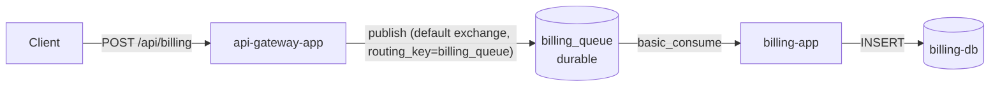

# RabbitMQ queue topology

Read straight from the actual pika code in `srcs/api-gateway-app/app/routes.py`
and `srcs/billing-app/app/consumer.py` — not a guess.

## Details

- **Exchange**: none — publishes go to RabbitMQ's built-in default exchange
  (`exchange=''`), which routes by routing key straight to a queue of the
  same name. No custom exchange or bindings to manage.
- **Queue**: single queue, name `billing_queue` (from the `RABBITMQ_QUEUE`
  env var), declared `durable=true` by both the publisher and the consumer
  so it survives a broker restart.
- **Delivery mode**: `delivery_mode=2` (persistent) on publish, so queued
  messages are written to disk, not just kept in memory.
- **Publisher confirms**: the gateway publishes with `confirm_delivery()`
  and `mandatory=True`, so it answers `200` only after RabbitMQ has stored
  the message in the queue, and `503` if it couldn't.
- **Consumption**: `billing-app` takes one message at a time
  (`prefetch_count=1`) and acks it (`basic_ack`) only after the DB insert
  succeeded. If billing-db can't be reached, it nacks with requeue
  (`basic_nack(requeue=True)`) and waits 5 seconds, so the order is retried
  until the database is back. A message it can't read (bad JSON, missing
  fields) is nacked without requeue: it is dropped instead of blocking the
  queue forever.
- **Message body**: raw JSON forwarded as-is from the gateway's request body,
  e.g. `{"user_id": "...", "number_of_items": 2, "total_amount": 41.98}`.

## Why this needs persistent storage on AWS

The queue is durable and messages are persistent, but that only protects
against a broker *restart* — the data still lives on whatever filesystem the
container sees. On ECS, a task's local filesystem is ephemeral: if the task
is replaced, `/var/lib/rabbitmq` is gone with it. This module attaches an EFS
volume (`efs.tf`) so RabbitMQ's data directory survives task replacement, not just
broker restarts.
