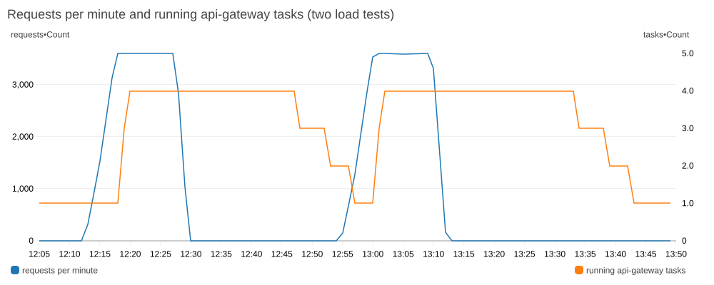
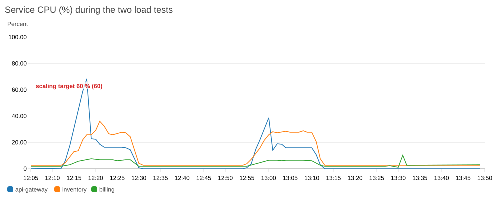
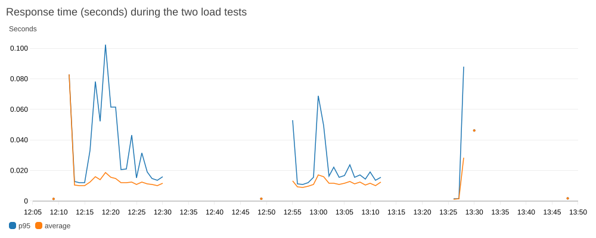

# Monitoring module (Task 5)

A CloudWatch dashboard and alarms for the whole project: the app (load
balancer and ECS services), the databases and RabbitMQ.

## What this creates

- 1 SNS topic + email subscription for alarm notifications
- 13 CloudWatch alarms, all emailing the SNS topic:
  - CPU, free storage, and connection count for both `inventory-db` and
    `billing-db` (6 alarms)
  - a log-based alarm that fires when `rabbit-queue` logs an error (1 alarm,
    backed by a log metric filter)
  - no healthy api-gateway task behind the load balancer for 2 minutes:
    the API is down (1 alarm)
  - more than `app_5xx_threshold` (default 10) server errors from the app
    in 5 minutes (1 alarm)
  - an app service (api-gateway, inventory, billing, rabbit-queue) has no
    running task for 3 minutes (4 alarms)
- 1 CloudWatch dashboard (`${project_name}-overview`), top to bottom:
  - **Traffic:** requests per minute and response time (p95 and average)
    through the load balancer
  - **Health:** HTTP 5xx/4xx errors, healthy and unhealthy api-gateway
    targets, and running tasks per service (shows auto-scaling)
  - **Resources:** CPU and memory of each ECS service
  - **From the logs:** billing orders saved per minute, and the latest
    errors logged by the app services
  - **Databases and queue:** RDS CPU, free storage and connections, the
    rabbit-queue error count, and rabbit-queue's recent logs

ECS reports one CPU sample per running task each minute, so the "running
tasks" chart and the "not running" alarms use the sample count of the
service's CPU metric. This avoids paying for Container Insights.

## Screenshots

Graphs of the same metrics during the two load tests of 2026-10-06 (see
[load-test/README.md](../../../load-test/README.md)), rendered by CloudWatch:



The gateway scales from 1 to 4 tasks a few minutes after the traffic
starts, then back to 1 task about 25 minutes after it stops.



The gateway's CPU drops below the 60 % target once the new tasks start.
inventory and billing stay low, so they keep 1 task.



Response time stays under 0.1 s during both tests.

## Dependencies

Reads state from the databases module (RDS instance identifiers), the
messaging module (the rabbit-queue CloudWatch log group) and the platform
module (cluster, services, load balancer, app log group), so all three
need to be applied first:

```bash
cd ../02-databases && terraform apply -var-file=terraform.tfvars
cd ../04-messaging  && terraform apply -var-file=terraform.tfvars
cd ../../houda/platform && terraform apply -var-file=terraform.tfvars
cd ../../aymen/05-monitoring && terraform apply -var-file=terraform.tfvars
```

## Usage

```bash
cp terraform.tfvars.example terraform.tfvars
# set alert_email to a real address you can check

terraform init
terraform plan -var-file=terraform.tfvars
terraform apply -var-file=terraform.tfvars
```

After `apply`, AWS emails `alert_email` a subscription confirmation link -
alarms stay silent for that address until it's clicked.

To show the monitoring:

```bash
terraform output -raw dashboard_url
aws cloudwatch describe-alarms --alarm-name-prefix cloud-design- \
  --query 'MetricAlarms[].[AlarmName,StateValue]' --output table
```

Stopping billing-service for more than 3 minutes (as in the billing
resilience demo of the main README) sends the
`cloud-design-billing-not-running` alarm email, and an OK email when it is
back.
