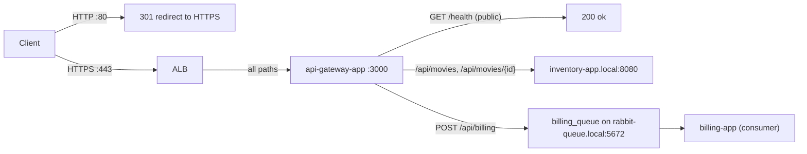

# Platform module (Tasks 6, 7, 8, 9)

Runs the application on AWS: the ECS cluster and its four services, the
public load balancer, service discovery, HTTPS, authentication, per-service
IAM, and auto-scaling. It builds on the networking, database and messaging
modules in `terraform/aymen/` and on `terraform/houda/ecr`.

## What this creates

| Area | Resources |
|------|-----------|
| Cluster (task 6) | ECS cluster (Fargate only), 3 task definitions, 4 services (`api-gateway`, `inventory`, `billing`, and `rabbit-queue` using the task definition from `aymen/04-messaging`), CloudWatch log group `/ecs/cloud-design` |
| Load balancer (task 7) | Internet-facing ALB in the public subnets, target group for `api-gateway-app:3000`, HTTPS listener, HTTP→HTTPS redirect |
| Service discovery (task 7) | Cloud Map private DNS namespace `local` with `inventory-app.local`, `billing-app.local`, `rabbit-queue.local` |
| Security (task 8) | ACM certificate, Cognito user pool + app client + test user, one execution role and one task role per app service, a security group for service-to-service traffic |
| Auto-scaling (task 9) | Target-tracking policies on CPU for the three app services, plus request count per target for the gateway |

## Before you apply

This module reads the other modules' outputs from their local state files
(`terraform_remote_state`), the same way the `aymen/` modules read each
other's. So everything must be applied from **one checkout** that contains
both `terraform/aymen/` and `terraform/houda/`, in this order:

1. `terraform/aymen/01-networking`
2. `terraform/aymen/02-databases`
3. `terraform/houda/ecr`, then `scripts/push-images.sh`
4. `terraform/aymen/04-messaging` with `container_image` set to the
   `rabbit_queue_image` output of step 3
5. this module

## Usage

```bash
cp terraform.tfvars.example terraform.tfvars
# optional: set domain_name + route53_zone_id to use your own domain

terraform init
terraform plan -var-file=terraform.tfvars
terraform apply -var-file=terraform.tfvars

terraform output app_url
```

Quick check once the services are running (2-3 minutes after apply):

```bash
APP_URL=$(terraform output -raw app_url)
curl -k "$APP_URL/health"                          # 200, no token needed
curl -k "$APP_URL/api/movies"                      # 401, token required

TOKEN=$(../../../scripts/get-token.sh)
curl -k -H "Authorization: Bearer $TOKEN" "$APP_URL/api/movies"
```

`-k` is needed while the load balancer uses the self-signed certificate.

## Outputs

`app_url`, `alb_dns_name`, `cluster_name`, `service_names`,
`internal_hostnames`, `log_group_name`, `cognito_user_pool_id`,
`cognito_client_id`, `test_user_secret_name`.

## Cluster access (task 6)

All commands assume `CLUSTER=cloud-design-cluster` and the region set in
`aws configure`.

```bash
# State of every service: desired vs running tasks, latest events
aws ecs describe-services --cluster $CLUSTER \
  --services api-gateway-service inventory-service billing-service rabbit-queue-service \
  --query 'services[].{name:serviceName,desired:desiredCount,running:runningCount,event:events[0].message}' \
  --output table

# Logs (one stream prefix per service)
aws logs tail /ecs/cloud-design --follow --log-stream-name-prefix inventory
aws logs tail /ecs/cloud-design-rabbit-queue --follow

# Why did a task stop?
aws ecs list-tasks --cluster $CLUSTER --service-name billing-service --desired-status STOPPED
aws ecs describe-tasks --cluster $CLUSTER --tasks <task-arn> --query 'tasks[].stoppedReason'

# Force a redeploy after pushing new images with the same tag
aws ecs update-service --cluster $CLUSTER --service inventory-service --force-new-deployment
```

**Shell inside a running container (ECS Exec).** The app services have
`enable_execute_command` on, and their task roles allow it. It needs the
Session Manager plugin locally, which installs without sudo:

```bash
curl -o /tmp/smp.deb https://s3.amazonaws.com/session-manager-downloads/plugin/latest/ubuntu_64bit/session-manager-plugin.deb
dpkg -x /tmp/smp.deb ~/.local/smp
ln -s ~/.local/smp/usr/local/sessionmanagerplugin/bin/session-manager-plugin ~/.local/bin/

TASK=$(aws ecs list-tasks --cluster $CLUSTER --service-name inventory-service --query 'taskArns[0]' --output text)
aws ecs execute-command --cluster $CLUSTER --task $TASK --container inventory-app --interactive --command /bin/sh
```

## Routing rules (task 7)



| Listener / path | Methods | Goes to | Auth |
|-----------------|---------|---------|------|
| `:80` anything | any | 301 to `https://` same URL | - |
| `:443` `/health` | GET | answered by api-gateway-app (also the ALB health check) | none |
| `:443` `/api/movies` | GET, POST, DELETE | proxied to `http://inventory-app.local:8080/api/movies` | Cognito token |
| `:443` `/api/movies/{id}` | GET, PUT, DELETE | proxied to `http://inventory-app.local:8080/api/movies/{id}` | Cognito token |
| `:443` `/api/billing` | POST | validated, then published to `billing_queue`; billing-app consumes it | Cognito token |

- The ALB has a single rule: forward everything to the gateway. The
  path routing lives in api-gateway-app, which is the component the project
  defines for that job; duplicating it as ALB rules would mean keeping two
  routing tables in sync.
- **Service discovery:** each ECS service registers its tasks' private IPs
  in Cloud Map. The gateway calls `inventory-app.local`, and the gateway and
  billing-app connect to `rabbit-queue.local`. When auto-scaling adds or
  removes tasks, ECS updates the DNS records (TTL 10 s), and a task that
  fails its container health check is removed from DNS.
- The gateway's security groups: Aymen's `app` group lets the ALB reach it
  on 3000, and `services-internal` lets it reach inventory-app on 8080.
  RabbitMQ and the databases accept the `app` group.

## Security decisions (task 8)

- **HTTPS everywhere public.** Port 80 only redirects. The HTTPS listener
  uses the `ELBSecurityPolicy-TLS13-1-2-2021-06` policy (TLS 1.2 and 1.3
  only). With `domain_name` and `route53_zone_id` set, the certificate is a
  public ACM certificate validated through Route 53. Without a domain, a
  self-signed certificate is imported into ACM instead: the traffic is
  still encrypted, but clients have to skip verification (`curl -k`). The
  ALB also drops malformed headers (`drop_invalid_header_fields`).
- **Authentication with Cognito.** Every `/api/*` request needs a Cognito
  access token (`Authorization: Bearer ...`). api-gateway-app checks the
  signature against the user pool's published keys, the expiry, the issuer,
  that it is an access token, and that it was issued to this app client
  (`srcs/api-gateway-app/app/auth.py`). `/health` stays open for the ALB.
  The ALB's built-in Cognito action was not used: it is a browser login
  flow based on cookies, which API clients like curl or k6 can't follow.
- **No plaintext credentials.** Database and RabbitMQ passwords are
  generated by the `aymen/` modules and stored in Secrets Manager. ECS
  injects them into the containers at start-up (`secrets` in the task
  definitions), so they don't appear in the repo, the images or the task
  definitions. The Cognito test user's password is generated too
  (`random_password`) and only readable from Secrets Manager.
  `terraform.tfvars` and `*.tfstate` are git-ignored; the state does
  contain these secrets, so it must stay on the machine that applies.
- **IAM scoped per service.** Each app service has its own execution role
  that can read only the secrets that service uses (gateway: RabbitMQ;
  inventory: inventory-db; billing: billing-db and RabbitMQ), and its own
  task role that allows only ECS Exec. None of the apps call AWS APIs, so
  their code gets no other AWS permission.
- **Network isolation.** Every task runs in a private subnet without a
  public IP; only the ALB is reachable from the internet. Security groups
  let each tier accept traffic only from the tier in front of it.

## Auto-scaling (task 9)

| Service | Policy | Target | Min / max |
|---------|--------|--------|-----------|
| api-gateway | CPU, and ALB requests per task | 60 %, 600 requests/min | 1 / 4 |
| inventory | CPU | 60 % | 1 / 4 |
| billing | CPU | 60 % | 1 / 4 |
| rabbit-queue | none (always 1) | - | 1 / 1 |

- With target tracking, AWS creates the CloudWatch alarms itself. It adds
  tasks after about 3 minutes above target and removes them after about 15
  minutes below it, waiting at least `scale_out_cooldown_seconds` (60) and
  `scale_in_cooldown_seconds` (180) between steps.
- The gateway mostly waits on the network, so request count reacts before
  CPU does. Having both policies means it scales out when either is high
  and scales in only when both are low.
- billing-app scales on CPU only. Queue depth would be a better signal,
  but the self-hosted RabbitMQ doesn't publish it to CloudWatch.
- rabbit-queue never scales: its data directory is on EFS and two brokers
  must not share it, so its deployments stop the old task first.
- All thresholds are variables. `load-test/` has the test that was used to
  check and tune them.

## Design notes

- **Fargate, no EC2.** There are no instances to patch, size or scale;
  each task gets the CPU and memory it asks for. EKS was not used: a
  Kubernetes control plane costs money per hour and adds a lot of moving
  parts for four services.
- **Cloud Map, not an internal load balancer.** Internal traffic uses DNS
  names that ECS keeps up to date. That costs cents per month (a private
  hosted zone and DNS queries) instead of an hourly load balancer, and adds
  no extra network hop. The trade-off is that clients spread load only
  through DNS round-robin.
- **Circuit breaker on deployments.** If the new tasks of a deployment keep
  failing, ECS rolls the service back to the last working task definition.
- **`desired_count` is ignored after creation**, so a later `terraform apply`
  doesn't reset a service that auto-scaling has scaled out.
- **Why a second security group.** Aymen's `app` group defines its rules
  inline, so a rule added to it from this module would be removed on the
  next apply of the networking module. `services-internal` is owned here and
  only allows port 8080 between its own members.
